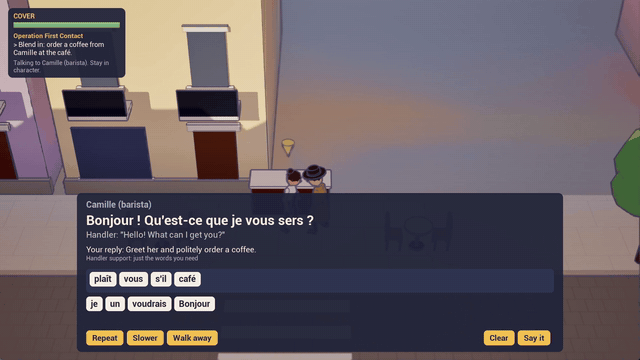

# LinguaSpy

**A stylized top-down spy game for learning a language.** You're an agent undercover in Paris, Madrid, Tokyo or
Rome. The locals speak the language. Your handler briefs you on the phrases you'll need, whispers translations in
your ear, and steps back as you improve. Say the wrong thing and your cover slips. Blow it, and you're pulled back
to the safe house to drill the phrases that gave you away.

*Unreal Engine 5.8 · C++ · Python editor tooling · Blender procedural art pipeline · prototype, v0.5*



Trailer and write-ups: [hamoodim.github.io/projects/linguaspy](https://hamoodim.github.io/projects/linguaspy/)

## Why it's built this way
Most phrase-tile language apps ask beginners to build sentences they've never heard. LinguaSpy's loop follows the
second-language acquisition research instead. Full write-up with citations: [`docs/Learning_Design.md`](docs/Learning_Design.md).

| Research finding | In the game |
|---|---|
| Comprehensible input before output (Krashen; VanPatten) | **Mission briefing**: hear, read and recognize the mission's 4–8 phrases before any cover is at stake |
| Scaffolding that fades; expertise reversal (Wood, Bruner & Ross; Kalyuga) | **Scaffold ladder** per phrase from its spaced-repetition strength: pick the sentence → words given → words + distractors → type the missing word → type it all |
| Prompts beat just giving the answer (Lyster & Ranta; Lyster & Saito) | **Feedback ladder**: a first mistake gets a targeted hint ("polite order: *je voudrais*"); only a second mistake shows and speaks the model answer |
| Noticing + brief explicit instruction (Schmidt; Norris & Ortega) | **Field notes**: short grammar notes that unlock after you've used a pattern a few times |
| Task-based learning, negotiation of meaning (Ellis; Long) | **Intel checks**: act on what a local said (the price, the time, the way to the station). **Repeat / Slower** buttons |
| Retrieval practice and spacing (Roediger & Karpicke; Cepeda et al.) | Post-mission **debrief**, Leitner **spaced repetition**, interleaved Safe house reviews |
| Language anxiety hurts performance (Horwitz et al.) | Low tutorial stakes. The **handler** goes from translating everything, to on call, to radio silence as your grades improve |
| Dual coding (Mayer; Paivio) | Every line is **voiced** (offline neural TTS at authoring time; nothing runs online) |

## Measuring whether it works
The prototype has its own evaluation tooling:
- **Assessment mode**: parallel pre/post test forms (listening, reading, gap-fill, sentence building), counterbalanced per participant, with no feedback during the test.
- **Pilot mode**: anonymous participant codes and a local JSONL learning log. It's off by default, and the game has no network code.
- **`Tools/Analysis/pilot_report.py`**: paired t-test, exact Wilcoxon, Cohen's d_z, accuracy by scaffold level and skill, helper reliance over time, and SUS. Standard library only, with a synthetic self-test.
- **Study protocol and facilitator kit**: [`docs/Pilot_Study_Protocol.md`](docs/Pilot_Study_Protocol.md), [`docs/pilot_kit/`](docs/pilot_kit/).

**Status:** a pilot with learners is planned. **No learning results are claimed yet.** This section will report the
real numbers once the study has run.

## Engineering highlights
- **Data-driven dialogue**: branching conversation graphs and mission objective graphs as DataAssets. The C++ never contains language content. A custom **Slate conversation editor** validates the graphs.
- **Pure, unit-tested core**: accent-aware grader for 4 languages (including unspaced Japanese chunks with romaji), scaffold policy, Leitner scheduler, fluency scoring, debrief selection and test counterbalancing. **23 automation tests** run headless.
- **Versioned save format** (v4) with step-by-step migrations and round-trip tests.
- **Content pipeline in Python**: scripts build every conversation, mission and city layout through the editor's Python API, and the editor tool stamps hand-edited assets so the scripts leave them alone.
- **Procedural character pipeline**: Blender Python builds 7 stylized characters rigged to the UE5 Mannequin skeleton. It works around an FBX/Interchange root-bone scale issue by baking ×100 into the rig with unit scale 0.01.
- **Toon rendering**: one master material with vertex colours, per-instance tint and dithered occlusion fade, plus a post-process with cel bands and depth/normal ink outlines.
- **Offline voices**: Piper TTS with CC-BY 4.0 French voices, one speaker per character, normal and slow takes, hashed so only changed lines are regenerated.

## Layout
```
Source/Personal/LinguaSpy/   gameplay (Data, Language, Dialogue, Mission, Save, Telemetry, Assessment, UI, Audio, Tests)
Source/PersonalEditor/       Conversation Editor (Slate)
Tools/Content/               content build scripts (Python, run in the editor)
Tools/Blender/               procedural characters and city kits
Tools/Analysis/              pilot report
docs/                        design, research, plans, logs, pilot kit, credits
```

## Running it
- **Editor:** open `Personal.uproject` in UE 5.8 (the C++ builds on first open), then press Play on `Lvl_MainMenu`.
- **Tests:** Session Frontend → Automation → `LinguaSpy`, or
  `UnrealEditor-Cmd.exe Personal.uproject -ExecCmds="Automation RunTests LinguaSpy; Quit" -unattended -nullrhi`
- **Pilot build:** see [`docs/pilot_kit/Laptop_Setup.md`](docs/pilot_kit/Laptop_Setup.md).

## Credits
Audio, voices and fonts: [`docs/Credits.md`](docs/Credits.md). Designed and led by Mohammad Mohammad, using Claude Code as an AI coding assistant.
